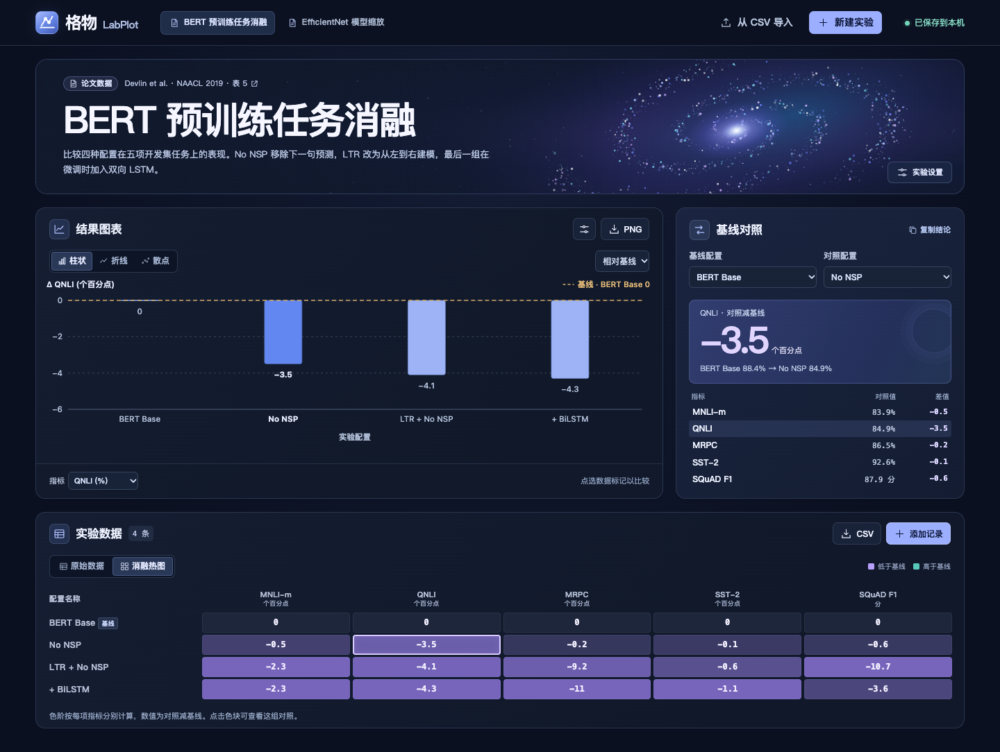

# 格物 LabPlot

一个能带去答辩现场的论文实验记录台。选定完整模型和消融配置，点击热图里的一个格子，即可对应到原始分数、图表和基线差值。数据、图表和星空动画都在浏览器本地运行。



## 直接使用

下载 [LabPlot.html](./LabPlot.html)，用桌面浏览器打开即可。若 GitHub 显示文件内容，点击文件工具栏里的 **Download raw file**。这个文件已包含全部样式、脚本和样例，打开后可断网演示。手机端从左上角打开实验册。

## 一分钟演示

1. 打开 **BERT 预训练任务消融**。初始基线为 BERT Base，对照为 No NSP。在 QNLI 上，准确率从 88.4% 变为 84.9%，相差 **−3.5 个百分点**。
2. 将基线改为 **LTR + No NSP**，再点热图中 **+ BiLSTM × SQuAD F1** 的格子。对比的是微调时增加 BiLSTM 的两种配置，F1 从 77.8 升至 84.9，相差 **+7.1 分**。点击“复制结论”可取走这组带来源的描述。
3. 切换“原始数值 / 相对基线”或图表类型。用“原始数据”中的铅笔改一条记录并保存，修改后的论文样例会显示“已编辑的论文数据”。刷新可恢复已保存的数据，点击 PNG 可取得带标题、单位、基线和来源的白底报告图。
4. 切换到 **EfficientNet 模型缩放**。散点图以参数量为 X 轴、ImageNet Top-1 准确率为 Y 轴。点击 B7 可与 B0 对照，也可以将横轴切换为 FLOPs。

## 记录自己的数据

- 新建实验，自定义指标名称与单位，再逐行添加、编辑或删除配置。也可以选择 CSV 文件或粘贴文本，一次导入多行。
- 柱状图和折线图按配置顺序展示 Y 指标，散点图按两个数值坐标绘制。可调整标题、颜色、网格和数值标签。
- 热图每格的数值是该配置减去所选基线，同一列使用同一色阶。百分比指标的差值用百分点表示，F1 示范数据按原论文的 0–100 记分。
- 导出 CSV 可带走原始数据和列单位。所选基线、图表样式和实验说明随实验册保存在当前浏览器。不同浏览器、文件路径或站点地址可能使用不同的本地存储空间。

CSV 首列是配置名称，后面至少两列数值指标。缺测留空，零可以正常录入。例如：

```csv
配置名称,训练耗时 [h],验证准确率 [%]
完整模型,3.2,91.4
移除注意力,2.6,88.9
```

## 运行、构建和测试

源码入口是 `index.html`。如需固定本地访问地址，可在本目录运行以下命令，然后打开 [本地工作台](http://127.0.0.1:8000/)。

```sh
python3 -m http.server 8000 --bind 127.0.0.1
```

修改源码后，用 Python 3 重新生成离线文件。运行单元测试需要 Node.js 20 或以上，全部命令均使用标准库。

```sh
python3 build.py
python3 build.py --check
node --test model.test.cjs chart.test.cjs
```

`model.js` 定义数据结构、论文样例、十进制差值与 CSV 读写。`chart.js` 生成交互图和可导出的报告图。`app.js` 管理表单、基线联动与本地保存。`stars.js` 绘制动态粒子，在页面不可见时暂停，并尊重系统的“减少动态效果”设置。

## 论文数据、开源参考与本项目实现

- **BERT 消融。** 四种配置和五项开发集指标取自 Devlin 等人的 NAACL 2019 论文表 5。最后一行在 LTR + No NSP 的基础上添加 BiLSTM。这些数值是论文报告结果。[BERT 表 5，PDF 第 8 页](https://aclanthology.org/N19-1423.pdf#page=8)
- **EfficientNet 缩放。** 八组 B0–B7 的参数量、FLOPs 和 ImageNet Top-1、Top-5 准确率取自 Tan 与 Le 的 ICML 2019 论文表 2。[EfficientNet 表 2，PDF 第 6 页](https://proceedings.mlr.press/v97/tan19a/tan19a.pdf#page=6)
- **交互参考。** MLflow 的实验运行对比启发了基线选择与逐指标对照。HiPlot 中数据点与记录的对应关系启发了热图、主图和表格的联动。[MLflow 仓库](https://github.com/mlflow/mlflow) · [HiPlot 仓库](https://github.com/facebookresearch/hiplot)
- **本项目实现。** 项目按赛题 4 独立编写，运行时使用浏览器原生 API。基线差值热图、可复制的对照读数、带出处的白底 PNG、编辑与刷新恢复，以及单文件离线分发均在本仓库实现。两项参考项目提供交互思路，本仓库独立实现了代码、样式、图标和粒子效果。

## AI 使用说明

用户确定了论文消融的演示场景和动态星空的视觉方向。Codex 参与数据核对、交互设计、代码实现、测试和文档编写。测试覆盖公式、缺测、CSV 往返、空图、负数坐标和离线构建。例如，审查中发现两个很接近的十进制分数相减时可能显示浮点尾数，项目新增回归用例，验证 `94.31 − 94.30 = 0.01`。
